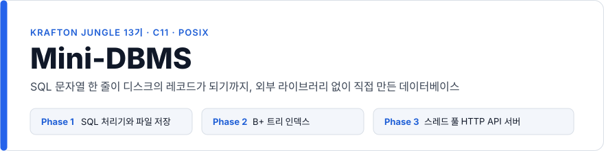
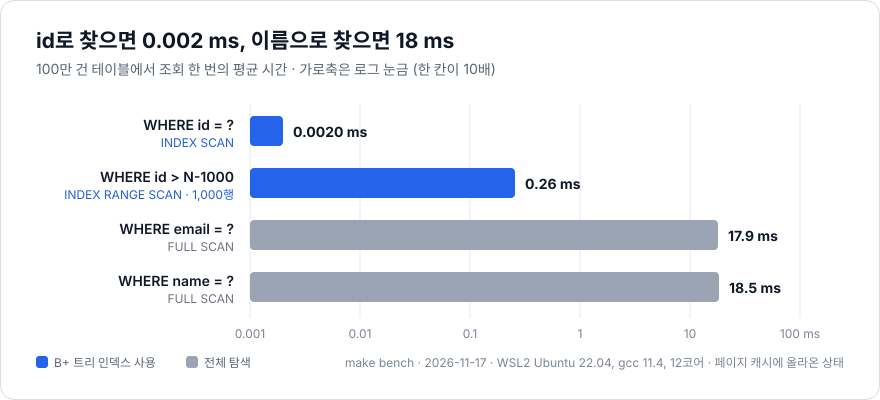
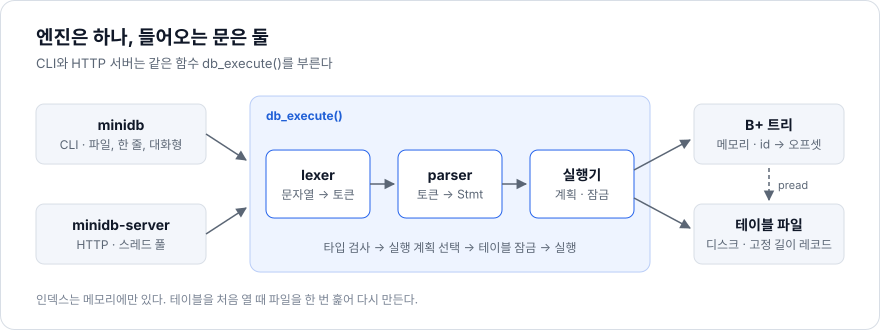
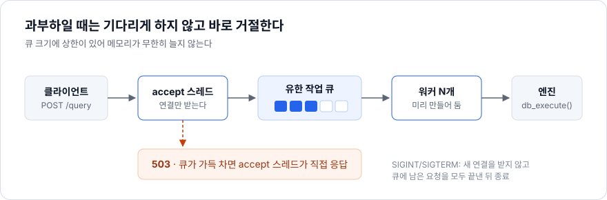

<p align="center">
  
</p>

<p align="center">
  <a href="https://github.com/minseongkim275-dotcom/mini-dbms/actions/workflows/ci.yml"></a>
  
  
  
</p>

SQL 문자열을 받아 파싱하고, 실행하고, 파일에 저장하고, 인덱스로 다시 찾아오는 데이터베이스를 C로 처음부터 만들었다. 외부 라이브러리 없이 C11과 POSIX API(pthread, 소켓)만 썼고, 같은 엔진을 CLI와 HTTP 서버가 함께 쓴다.

**목차** · [한눈에 보기](#한눈에-보기) · [30초 실행](#30초-실행) · [구조](#구조) · [설계 결정 3가지](#설계-결정-3가지) · [단계별 상세](#단계별-상세) · [검증](#검증) · [한계와 다음 단계](#한계와-다음-단계)

## 한눈에 보기

| | 결과 | 어떻게 |
|---|---|---|
| **인덱스 조회** | 100만 건에서 `id` 조회 한 번에 **0.002 ms** | B+ 트리를 4단계만 내려간 뒤 `pread` 한 번 |
| **전체 탐색과의 차이** | 같은 테이블에서 **약 9천 배** | 인덱스가 없는 컬럼은 100만 건을 모두 읽어 약 18 ms |
| **삽입** | **초당 약 53만 행** | SQL 문자열 100만 개를 하나씩 파싱해 고정 길이 레코드로 추가 |
| **재시작** | 100만 건 인덱스를 **약 78 ms**에 다시 만듦 | 인덱스는 메모리에만 두고, 열 때 파일을 한 번 훑는다 |

<p align="center">
  
</p>

수치는 `make bench`를 한 번 돌린 값이다(2026-11-17, WSL2 Ubuntu 22.04, gcc 11.4, 12코어, 데이터는 `/tmp`). 파일이 OS 페이지 캐시에 올라와 있는 상태라 디스크를 실제로 읽는 시간은 들어 있지 않고, 실행할 때마다 조금씩 달라진다.

## 30초 실행

Linux 또는 WSL에서 gcc와 make만 있으면 된다.

```bash
make                                    # build/minidb, build/minidb-server, build/bench
./build/minidb -f examples/demo.sql     # SQL 파일 실행
```

```
inserted 1 row (id = 1)
...
+----+---------+-----+----------------------+
| id | name    | age | email                |
+----+---------+-----+----------------------+
| 1  | alice   | 30  | alice@example.com    |
| 2  | bob     | 25  | bob@example.com      |
| 3  | carol   | 41  |                      |
| 4  | dave    | 25  | dave@example.com     |
| 5  | 김민성  | 27  | minseong@example.com |
| 6  | O'Brien | 52  | obrien@example.com   |
+----+---------+-----+----------------------+
(6 rows)
...
plan: INDEX SCAN (B+Tree point lookup on id)
plan: INDEX RANGE SCAN (B+Tree leaf chain on id)
...
plan: FULL SCAN (linear)
```

같은 데이터를 HTTP로도 조회할 수 있다.

```bash
./build/minidb-server -p 8080 -t 8 &
curl -X POST localhost:8080/query -d "SELECT * FROM users WHERE id = 1"
```

```json
{"ok":true,"type":"select","columns":["id","name","age","email"],
 "rows":[[1,"alice",30,"alice@example.com"]],"row_count":1,"truncated":false,
 "plan":"INDEX SCAN (B+Tree point lookup on id)","rows_examined":1,"elapsed_ms":0.044}
```

그 밖의 실행 방법:

```bash
./build/minidb -e "SELECT * FROM users;"     # 한 줄 실행
./build/minidb                               # 대화형 프롬프트
make test                                    # 단위 테스트 + CLI/서버 기능 테스트
make bench                                   # 100만 건 삽입 후 인덱스와 전체 탐색 비교
```

## 구조

<p align="center">
  
</p>

| 파일 | 역할 |
|---|---|
| `src/lexer.c` | SQL 문자열을 토큰으로 분해. 오류 위치(줄, 열) 추적 |
| `src/parser.c` | 재귀 하강 파서. 토큰을 `Stmt` 구조체로 변환 |
| `src/bptree.c` | 메모리 기반 B+ 트리 (`id → 파일 오프셋`) |
| `src/table.c` | 스키마 로드, 고정 길이 레코드 파일 읽기/쓰기, 인덱스 재구성 |
| `src/db.c` | 실행기. 타입 검사, 실행 계획 선택, 테이블 잠금 |
| `src/format.c` | 결과를 표 또는 JSON으로 출력 |
| `src/threadpool.c` | 고정 워커 스레드 + 유한 작업 큐 |
| `src/http.c` | HTTP 요청 헤더 파싱, JSON 문자열 추출 |
| `src/server.c` | 소켓 accept, 라우팅, 응답 |
| `src/main.c`, `src/bench.c` | CLI, 벤치마크 |

## 설계 결정 3가지

### 1. 레코드를 고정 길이로 저장한다

```
[16바이트 헤더: "MDB1" + 레코드 크기] [레코드 1] [레코드 2] ...
레코드 = INT 8바이트 | VARCHAR(n) n+1바이트(NUL 채움) | ...
```

- **고른 이유**: 레코드 위치를 오프셋 하나로 가리킬 수 있다. B+ 트리가 `id → 오프셋`만 갖고 있으면 `pread` 한 번으로 레코드를 읽는다.
- **버린 것**: CSV는 사람이 읽기 쉽지만 행마다 길이가 달라, 파싱하지 않고는 원하는 행으로 건너뛸 수 없다.
- **치른 값**: 짧은 문자열도 `VARCHAR(n)`의 최대 길이만큼 자리를 차지한다.

### 2. 인덱스는 리프가 옆으로 이어진 B+ 트리다

- 차수는 64다. 내부 노드는 구분 키만 갖고, 리프가 `(id, 파일 오프셋)`을 갖는다.
- 리프가 넘치면 반으로 나누고 오른쪽 첫 키를 부모로 **복사**한다. 내부 노드가 넘치면 가운데 키를 부모로 **이동**한다. 루트가 나뉘면 트리 높이가 1 늘어난다.
- 리프끼리 연결 리스트로 이어져 있어서, 범위 조회는 시작 리프를 찾은 뒤 옆으로만 이동한다. 위 그래프에서 1,000행 범위 조회가 0.26 ms인 이유다.
- 조건에 따라 실행 계획이 달라지고, `EXPLAIN`으로 확인할 수 있다.

| 조건 | 계획 | 읽는 레코드 수 |
|---|---|---|
| `WHERE id = v` | INDEX SCAN | 1 |
| `WHERE id < <= > >= v` | INDEX RANGE SCAN | 결과 행 수만큼 |
| `COUNT(*)` (조건 없음) | METADATA | 0 |
| 그 외 (`id != v` 포함) | FULL SCAN | 전체 |

### 3. 읽기·쓰기 잠금을 쓰기 우선으로 바꿨다

테이블마다 `pthread_rwlock`을 하나 두어 `SELECT`끼리는 동시에 실행하고 `INSERT`는 혼자 실행하게 했다.

- **문제**: AddressSanitizer 빌드에서 동시성 테스트가 10분 넘게 끝나지 않았다.
- **원인**: glibc의 기본값은 읽기 우선이다. `SELECT`가 끊이지 않으면 읽기 잠금이 풀릴 틈이 없어 `INSERT`가 계속 기다린다.
- **해결**: 잠금 속성을 `PTHREAD_RWLOCK_PREFER_WRITER_NONRECURSIVE_NP`로 설정해, 쓰기가 기다리고 있으면 새 읽기가 끼어들지 못하게 했다.

| 공유 자원 | 보호 방법 |
|---|---|
| 테이블 (파일 끝 위치, 다음 id, B+ 트리) | 테이블별 `pthread_rwlock` (쓰기 우선) |
| 데이터 파일 | `pread`/`pwrite`만 사용. 파일 오프셋을 공유하지 않으므로 읽기끼리 간섭이 없다 |
| 열린 테이블 목록 | 뮤텍스 |
| 통계 카운터 | C11 atomic |
| 작업 큐 | 뮤텍스 + 조건 변수 |

## 단계별 상세

<details>
<summary><b>Phase 1 — SQL 처리기</b> (문법, 스키마, 오류 처리)</summary>

<br>

**지원 문법**

```
[EXPLAIN] SELECT * | COUNT(*) | col, ... FROM table [WHERE col op value] [LIMIT n];
INSERT INTO table [(col, ...)] VALUES (value, ...);

op    : =  !=  <>  <  <=  >  >=
value : 정수 | '문자열'   (작은따옴표는 '' 로 표기)
```

키워드와 식별자는 대소문자를 구분하지 않고, `--` 주석을 쓸 수 있다.

스크립트 중간의 문장이 실패해도 오류를 출력하고 다음 문장을 계속 실행한다. 하나라도 실패하면 종료 코드는 1이다.

**스키마**

`CREATE TABLE`은 구현하지 않았다. 테이블은 스키마 파일로 미리 정의한다.

```
# data/users.schema
id INT
name VARCHAR(32)
age INT
email VARCHAR(64)
```

- 타입은 `INT`(64비트 정수)와 `VARCHAR(n)`(1 ≤ n ≤ 255, 바이트 기준)이다.
- 첫 컬럼은 반드시 `id INT`이고, `INSERT` 때 1부터 자동으로 부여된다.
- 데이터는 `data/<table>.tbl`에 저장한다.

</details>

<details>
<summary><b>Phase 2 — B+ 트리 인덱스</b> (벤치마크 원본 출력, 대량 데이터 넣기)</summary>

<br>

**`make bench` 출력**

```
== minidb benchmark: 1000000 rows ==

INSERT x 1000000            :    1879.7 ms total  (531998 rows/s)

query                              plan                     avg time
WHERE id = ?    (10000 runs)       INDEX SCAN              0.0020 ms
WHERE name = ?  (10 runs)          FULL SCAN              18.4594 ms
WHERE email = ? (10 runs)          FULL SCAN              17.8829 ms
WHERE id > N-1000 (1000 rows)      INDEX RANGE SCAN        0.2558 ms

index lookup is 9088x faster than a linear scan on name
reopen + index rebuild              :      77.9 ms
```

인덱스 조회는 트리 높이(100만 건에서 4단계)만큼만 내려가므로 데이터가 늘어도 거의 일정하고, 전체 탐색은 행 수에 비례한다.

**SQL 파일로 대량 데이터 넣기**

```bash
python3 tools/gen_sql.py 1000000 > /tmp/users_1m.sql
./build/minidb -q -f /tmp/users_1m.sql        # -q: INSERT 결과 줄 생략
./build/minidb -t -e "SELECT * FROM users WHERE id = 777777;"   # -t: 계획과 시간 출력
```

**실행 계획 확인**

```
$ ./build/minidb -e "EXPLAIN SELECT * FROM users WHERE id = 3; EXPLAIN SELECT * FROM users WHERE age = 25;"
plan: INDEX SCAN (B+Tree point lookup on id)
plan: FULL SCAN (linear)
```

</details>

<details>
<summary><b>Phase 3 — API 서버</b> (엔드포인트, 요청 처리 흐름)</summary>

<br>

```bash
./build/minidb-server -p 8080 -d data -t 8 -q 256 -m 10000
#   -t 워커 스레드 수   -q 대기 큐 크기   -m SELECT 한 번에 돌려줄 최대 행 수
```

| 엔드포인트 | 설명 |
|---|---|
| `POST /query` | 본문은 SQL 텍스트, 또는 `Content-Type: application/json`과 `{"sql": "..."}`. 요청당 문장 하나 |
| `GET /health` | 상태 확인 |
| `GET /stats` | 요청 수, 503 거절 수, 활성/대기 작업 수, 계획별 실행 횟수 |

```
$ curl -X POST localhost:8080/query -H 'Content-Type: application/json' \
       -d '{"sql": "INSERT INTO users VALUES ('\''dave'\'', 41, '\''dave@example.com'\'')"}'
{"ok":true,"type":"insert","id":7,"rows_affected":1,"elapsed_ms":0.026}

$ curl -X POST localhost:8080/query -d "SELECT * FROM ghost"
{"ok":false,"error":"table 'ghost' does not exist"}        # HTTP 400
```

<p align="center">
  
</p>

- 스레드를 요청마다 만들지 않고, 미리 만들어 둔 워커가 큐에서 작업을 꺼낸다. 워커는 뮤텍스와 조건 변수로 대기한다.
- 넘치는 요청은 기다리게 하지 않고 바로 503으로 돌려보낸다.
- 요청당 연결 하나다. 헤더 8KB, 본문 1MB, 수신 5초로 제한한다.
- 응답 행 수가 `-m` 값을 넘으면 잘라 내고 `"truncated": true`로 알린다.

</details>

## 검증

```bash
make test     # 전체
make unit     # 단위 테스트만
make asan     # AddressSanitizer로 전체 테스트
make tsan     # ThreadSanitizer로 단위 테스트
```

`main`과 `dev`에 push하거나 PR을 열면 GitHub Actions가 `make test`(경고를 오류로 처리)와 `make asan`을 돌린다.

| 대상 | 확인하는 것 |
|---|---|
| `test_lexer` | 토큰 종류, 따옴표 이스케이프, 정수 범위, 길이 제한, 주석, 줄/열 위치 |
| `test_parser` | 정상 문장, 문법 오류 메시지와 위치, 예약어, 오류 뒤 다음 문장 복구 |
| `test_bptree` | 오름차순/내림차순/무작위 20만 건 삽입 후 구조 불변식 검사, 분할 경계, 중복 키, 범위 조회 |
| `test_table` | 스키마 오류, 추가/읽기/스캔, 재시작 후 인덱스 재구성, 잘린 레코드 복구, 스키마 불일치 감지 |
| `test_db` | 실행 계획 선택, 읽은 레코드 수, 타입/개수/길이 오류, int64 경계값, LIMIT, 행 수 제한, JSON 출력 |
| `test_http` | 요청 헤더 파싱과 잘못된 요청, JSON 이스케이프(`\uXXXX`, 서로게이트 쌍) |
| `test_threadpool` | 모든 작업이 한 번씩 실행, 큐가 가득 차면 거절, 실제 병렬 실행, 종료 시 큐 비우기 |
| `test_concurrency` | 쓰기 8 + 읽기 4 스레드 동시 실행. id 중복/누락 없음, 읽은 행이 항상 완전함 |
| `test_cli.sh` | SQL 파일 실행 결과를 기대 출력과 비교, 프로세스 재시작 후 데이터 유지 |
| `test_server.sh` | 엔드포인트, 오류 코드(400/404/405/413/431/503), 동시 삽입 800건, 정상 종료, 재시작 |

## 한계와 다음 단계

- `CREATE TABLE`, `UPDATE`, `DELETE`, `JOIN`, 다중 조건 `WHERE`(AND/OR)는 없다.
- 인덱스는 `id`에만 있고 메모리에만 존재한다. 시작할 때 재구성하므로 테이블이 클수록 첫 조회가 느리다(100만 건에 약 80 ms).
- `INSERT`마다 `fsync`하지 않는다. 프로세스가 죽어도 데이터는 남지만, 전원이 나가면 마지막 몇 건을 잃을 수 있다.
- 정수는 호스트 바이트 순서로 저장하므로 데이터 파일을 엔디언이 다른 기기로 옮길 수 없다.
- HTTP는 요청당 연결 하나(keep-alive 없음)이고 TLS와 인증이 없다.

다음에 한다면 보조 인덱스(`name`, `email`), 디스크 기반 인덱스, `DELETE`와 빈 공간 재사용 순서로 넣을 계획이다.

설계 문서: [docs/superpowers/specs/2026-11-11-mini-dbms-design.md](docs/superpowers/specs/2026-11-11-mini-dbms-design.md)
